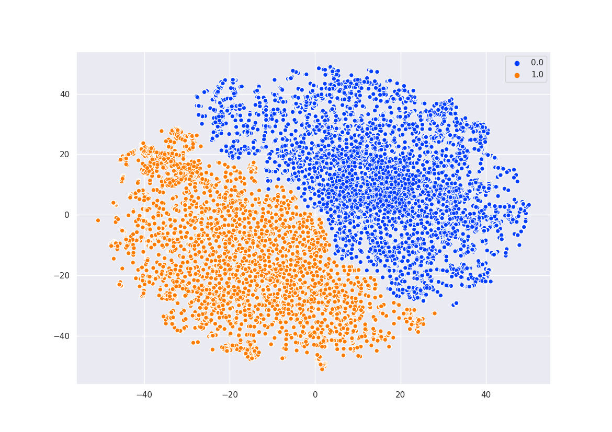
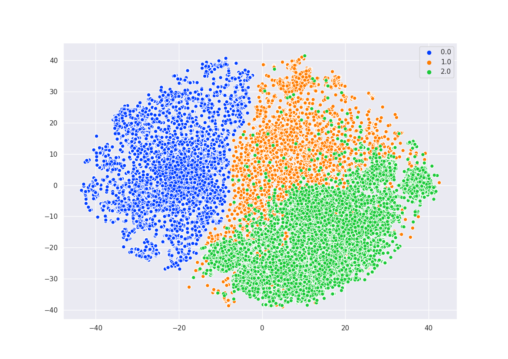
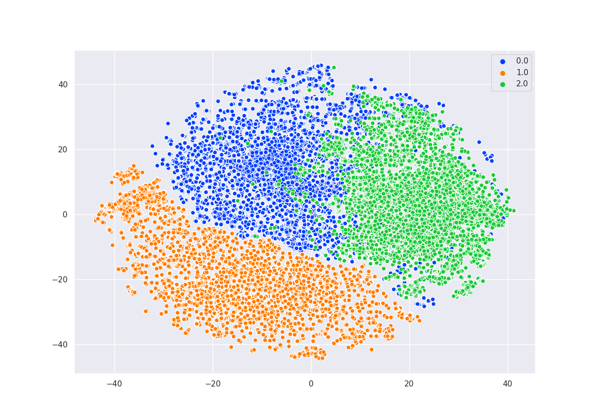
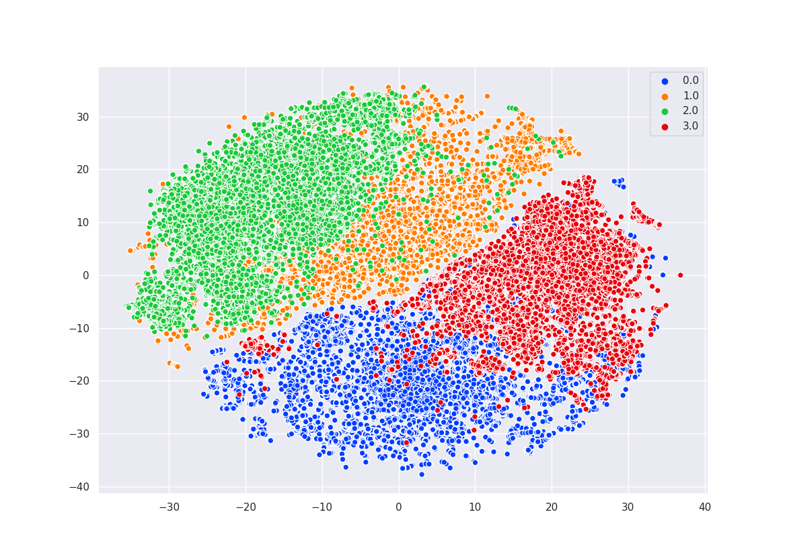
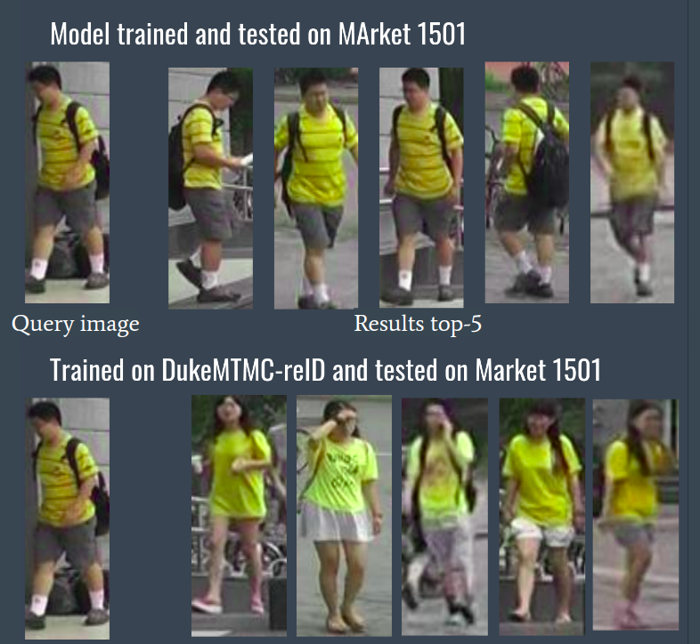
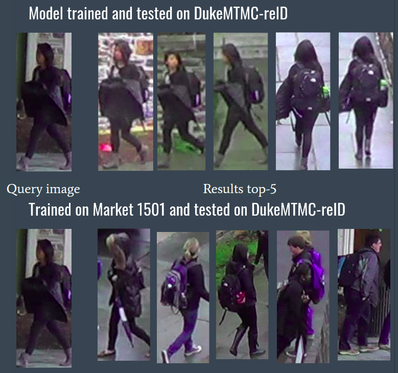

# Multi-source Person Re-Identification: A Study of Domain Shift

A person re-identification (re-ID) codebase for training and evaluating CNN embeddings **within a single dataset** and **across datasets**, used to observe and visualize the domain shift that appears when a model trained on one dataset (e.g. Market-1501) is tested on another (e.g. DukeMTMC-reID).

## Overview

This project fine-tunes standard re-ID backbones (ResNet-50, DenseNet-121, NASNet, PCB) on Market-1501 and DukeMTMC-reID, then extracts and compares features across domains. Cross-domain testing scripts run a model trained on one dataset against the query/gallery of the other, and t-SNE scripts plot the resulting 512-d feature distributions to make the domain gap visible. The core re-ID pipeline is built on top of [Zhedong Zheng's `Person_reID_baseline_pytorch`](https://github.com/layumi/Person_reID_baseline_pytorch); the cross-domain testing, t-SNE domain-shift analysis, and additional domain-adaptation experiments are the contributions of this repository.

All runnable code lives under the [`code/`](code) directory.

## Requirements

There is no `requirements.txt` or `environment.yml` in the repo; the following are inferred from the imports.

Core re-ID pipeline (PyTorch):
- Python 3
- `torch`, `torchvision`
- `torchsummary`
- `numpy`, `scipy`
- `pyyaml`
- `matplotlib`
- `Pillow`
- (optional) [NVIDIA apex](https://github.com/NVIDIA/apex) — only needed for `--fp16` low-precision training

t-SNE visualizations ([`code/tsne/`](code/tsne)):
- `MulticoreTSNE`
- `seaborn`

Domain-adaptation experiments ([`code/multi-source/`](code/multi-source)):
- `tensorflow`, `keras`, `scikit-learn`
- a `flip_gradient` module (DANN gradient-reversal layer) — **not bundled** in this repo and must be supplied separately

## Usage

Run the commands below from inside the `code/` directory.

### 1. Prepare the data

Edit the `download_path` at the top of the prepare script to point to your extracted dataset, then run it. This reorganizes the dataset into a `pytorch/` subfolder with `train`, `val`, `train_all`, `query`, and `gallery` splits that `torchvision.datasets.ImageFolder` can read.

```bash
python prepare.py          # Market-1501
python prepare_duke.py     # DukeMTMC-reID
python prepare_viper.py    # VIPeR
```

### 2. Train

Set `--data_dir` to the `pytorch/` folder created above (the scripts default to a hard-coded `/home/dipesh/...` path).

```bash
python train.py --gpu_ids 0 --name ft_ResNet50 --train_all --batchsize 32 --data_dir <path>/pytorch
python train_duke.py --gpu_ids 0 --name duke --train_all --batchsize 32 --data_dir <path>/pytorch
```

Useful flags: `--erasing_p 0.5` (random erasing), `--use_dense` (DenseNet-121), `--use_NAS` (NASNet), `--PCB` (PCB backbone), `--color_jitter`, `--warm_epoch`, `--lr`, `--fp16`. Checkpoints and the training config (`opts.yaml`) are written to `./model/<name>/`.

> **Note:** the committed `train.py` contains a leftover debug block near the model setup:
> ```python
> summary(model, (3,384,192).cuda())
> exit()
> ```
> This runs before the optimizer/training loop and will stop (and error on the tuple `.cuda()` call) before any training happens. Remove these two lines to run a full training.

### 3. Extract features (test)

`test.py` loads the config from `./model/<name>/opts.yaml`, extracts features for the query and gallery of `--test_dir`, and writes them to `pytorch_result.mat`.

```bash
# same-domain: model and data from the same dataset
python test.py --gpu_ids 0 --name ft_ResNet50 --test_dir <path>/pytorch --batchsize 32 --which_epoch 59
python test_duke.py --gpu_ids 0 --name duke --test_dir <duke_path>/pytorch --batchsize 32

# cross-domain: model trained on one dataset, tested on the other (domain shift)
python test_cross.py --gpu_ids 0 --name ft_ResNet50 --test_dir <duke_path>/pytorch
```

### 4. Evaluate

```bash
python evaluate.py          # CPU; prints Rank@1, Rank@5, Rank@10, mAP
python evaluate_gpu.py      # faster GPU evaluation
python evaluate_rerank.py   # evaluation with k-reciprocal re-ranking
```

### 5. Visualize a single query

```bash
python demo.py --query_index 777 --test_dir <path>/pytorch      # same-domain
python demo_cross.py --query_index 777                          # cross-domain
python demo_duke.py --query_index 777
```

### 6. t-SNE domain-shift plots

The scripts in [`code/tsne/`](code/tsne) load the `.mat` feature files produced by the test scripts and render the t-SNE figures shown below.

```bash
python tsne/tsne.py           # combined Market/Duke and cross-domain features
python tsne/tsne_md.py
python tsne/tsne_separate.py
```

### Additional experiments

- [`code/few_shot_learning/`](code/few_shot_learning) — a few-shot variant of the re-ID `train.py`/`test.py`/`model.py`.
- [`code/multi-source/`](code/multi-source) — separate TensorFlow/Keras domain-adaptation experiments (DANN with a gradient-reversal layer) on the Office-31, Office-Home, and ImageCLEF-DA benchmarks (`cvpr_opms1_psudolabel_off31.py`, `cvpr_opms1_psudolabel_off_home.py`, `cvpr_opms1_psudolabel_ipc.py`, with matching notebooks). These require the external `flip_gradient` module noted above.

## Model architectures

Defined in [`code/model.py`](code/model.py): `ft_net` (ResNet-50), `ft_net_dense` (DenseNet-121), `ft_net_NAS`, `ft_net_middle`, and `PCB` / `PCB_test`.

## Results / Figures

### Feature distributions per dataset
Features extracted after training and testing each model on its own dataset. In the shared 512-d space the Market-1501 and DukeMTMC-reID features occupy clearly separate regions — evidence of domain shift.



### Cross-domain feature mixing
Model trained on DukeMTMC-reID, queried with Market-1501 images (green = cross features):



Model trained on Market-1501, queried with DukeMTMC-reID images (green = cross features):



Both cross-domain cases overlaid:



### Query retrieval illustration
Retrieval results are strong when the model is trained and tested on the same dataset, and fail under cross-domain testing due to the domain gap.

Tested on Market-1501, models trained on Duke vs. Market:



Tested on DukeMTMC-reID, models trained on Duke vs. Market:



Per-query result crops are also stored under [`code/reid_results/`](code/reid_results) (e.g. `market-to-market/`, `market-to-duke/`, `duke-to-market/`, `duke-to-duke/`).

## Datasets

- **Market-1501** — person re-ID benchmark.
- **DukeMTMC-reID** — person re-ID benchmark (note: withdrawn by its original authors).
- **VIPeR** — small-scale re-ID dataset (`prepare_viper.py`).
- **Office-31**, **Office-Home**, **ImageCLEF-DA** — used by the domain-adaptation experiments in `code/multi-source/`.

## Citation / Acknowledgements

The core re-ID training/testing/evaluation pipeline is derived from [`Person_reID_baseline_pytorch`](https://github.com/layumi/Person_reID_baseline_pytorch) by Zhedong Zheng (MIT License, see [`code/LICENSE`](code/LICENSE)). If you use this code, please also credit the underlying baseline:

```bibtex
@article{zheng2017discriminatively,
  title={A discriminatively learned CNN embedding for person reidentification},
  author={Zheng, Zhedong and Zheng, Liang and Yang, Yi},
  journal={ACM Transactions on Multimedia Computing, Communications, and Applications (TOMM)},
  volume={14},
  number={1},
  pages={1--20},
  year={2017},
  publisher={ACM}
}
```

## License

This repository is released under the MIT License (see [`LICENSE`](LICENSE)). The code under `code/` retains its own MIT License from the upstream baseline (see [`code/LICENSE`](code/LICENSE)).
